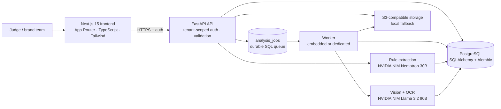

# INKLOOM AI

### AI-Powered Advertising Compliance & Brand Governance Platform

> **Inkloom AI turns a company's unstructured brand guidelines into traceable, versioned
> compliance rules — then audits ad creatives against those rules before they go live.**

Built for **CodeNexus India 2026 · Round 3: The Final Product** by **Team Tensor Titans**.

[](https://inkloom-ai.shubhamos.com)
[](https://inkloom-backend-yw07.onrender.com/api/v1/health)
[](#testing)
[](https://github.com/shubhamos-ai/inkloomai)

`Next.js 15` · `React 18` · `TypeScript` · `Tailwind` · `Framer Motion` · `FastAPI` ·
`SQLAlchemy` · `Alembic` · `PostgreSQL` · `NVIDIA NIM` · `S3-compatible storage` · `Render`

---

## At a Glance

| | |
| --- | --- |
| **What it is** | A multi-tenant SaaS that converts brandbooks into machine-checkable rules and audits ad creatives before publication. |
| **Who it is for** | D2C brands, ad agencies, marketing teams and compliance reviewers. |
| **Core breakthrough** | A traceable LLM rule-extraction pipeline: every rule keeps the **exact source quote** it came from, and every change is versioned. |
| **AI stack** | NVIDIA NIM **Llama 3.2 90B Vision** for creative inspection; **Nemotron 3.5 Lightning 30B** for fast, structured rule extraction. |
| **Live status** | Frontend, API and PostgreSQL are deployed on Render. Storage is local on the free tier; S3-compatible storage is implemented and configurable. |
| **Team** | Shubham Chawhan (Team Leader) · Shivam Panchal (Architecture Lead) — MBIT |
| **Repository** | <https://github.com/shubhamos-ai/inkloomai> |

### Production links

| Surface | URL | Status |
| --- | --- | --- |
| **Web app (custom domain)** | <https://inkloom-ai.shubhamos.com> | `200`, verified Render custom domain |
| **Web app (Render fallback)** | <https://inkloom-frontend-rwy2.onrender.com> | `200` |
| **API health** | <https://inkloom-backend-yw07.onrender.com/api/v1/health> | `200`, `database=connected` |
| **Repository** | <https://github.com/shubhamos-ai/inkloomai> | public |

> **Free-tier note:** Render free web services sleep after inactivity. The first request can
> take 30–60 seconds; the UI shows a “connecting” state and retries instead of claiming the
> backend is offline.

---

## The 30-Second Pitch

Brand compliance today lives in PDFs, spreadsheets and manual review. That fails in three
ways:

1. **Rules are unstructured** — brandbooks describe intent, not testable rules.
2. **Evidence is untraceable** — a reviewer cannot show which clause a finding came from.
3. **Review is too late** — violations are found after the campaign is live.

Inkloom AI fixes the whole loop:

| Step | What happens |
| --- | --- |
| **1 · Ingest** | Paste guidelines or upload PDF / DOCX / TXT / Markdown. |
| **2 · Extract** | An LLM proposes categorized rules, each with a verbatim `source_text` quote. |
| **3 · Review** | A human edits and approves proposals in **Brand Brain Studio** — nothing is auto-saved. |
| **4 · Version** | Committed rules become `BrandRule` rows with an immutable version history. |
| **5 · Audit** | A vision model inspects the creative, OCRs the copy and evaluates it rule by rule. |
| **6 · Report** | A scored, auditable report shows violations, evidence, severity, confidence and fixes. |

**The result:** every creative is checked against the brand's *actual* rules, with a quote
trail back to the source document.

---

## Judge's 60-Second Demo

Open **<https://inkloom-ai.shubhamos.com>** and follow this path:

| # | Action | What to look for |
| --- | --- | --- |
| 1 | **Create account** (`/register`) or **sign in** (`/login`) | Real auth; no mock session. |
| 2 | **Add your organisation** → click **Use Demo** | Prefills `VELORA Skincare Laboratories`, the skincare industry and the full **8,927-character** VELORA guidelines. |
| 3 | **Initialize Workspace** | Dashboard for the new tenant workspace. |
| 4 | Open **Brand Brain** → **Extract Rules with AI** | Proposals arrive with category, severity, confidence and the exact source quote. Expect **~1–2 minutes** on the free tier. |
| 5 | Review and **commit** the rules you approve | Only approved rules are saved; every save writes a version snapshot. |
| 6 | Open **Analyse** → upload a creative | Job returns `202` immediately, then `queued → processing → completed`. |
| 7 | Open the report | Score, violations, OCR text, visual observations, model metadata and corrective actions. |
| 8 | Try **History**, **Settings**, then **Sign out** and sign back in | Tenant-scoped data, real session invalidation. |

**Verified live on 12 Nov 2026:** a VELORA extraction run completed in **57 seconds** with
**58 proposals across 7 categories**, and only **9** proposals rejected by the verbatim-quote
check. All **58 reviewed proposals then committed successfully**, each with a version
snapshot. A VELORA creative audit evaluated all 58 active rules in **136 seconds** across
**3 batched passes**, producing **6 critical/major violations**, 30 passed checks and 22
honest inconclusive checks — it correctly caught “CURES ACNE IN 3 DAYS” and
“100% GUARANTEED RESULTS”.

> **Tip for judges:** if the page is cold, wait for the “connecting” banner to clear. The
> first request wakes the free Render instance.

---

## What Makes It Different

| Capability | Typical manual review | Inkloom AI |
| --- | --- | --- |
| **Rule source** | PDFs and tribal knowledge | Categorized rules extracted from the actual brandbook |
| **Evidence** | “I think this is off-brand” | Every rule stores a verbatim `source_text` quote |
| **Traceability** | None | Immutable `BrandRuleVersion` history per rule |
| **AI safety** | Trust the model | Human review gate; non-verbatim proposals are rejected and reported |
| **Audit speed** | Hours per creative | Async vision audit in seconds to a couple of minutes |
| **Tenant isolation** | Shared spreadsheets | `company_id` scoping enforced in the API dependency layer |
| **Failure handling** | Silent retries or fake results | Classified provider errors, backoff, attempts, manual retry |
| **Audit output** | Checklist | Scored report with OCR, visual evidence, severity and fixes |

---

## Round 3 Commitments — Delivered

### Commitment 01 — Traceable Brand-Rule Extraction & Versioning

**Goal:** convert uploaded or pasted guidelines into structured, categorized, versioned
rules while preserving the exact original wording as evidence.

**Delivered:**

- **Multi-format ingestion** — direct text, PDF, DOCX, TXT and Markdown, parsed server-side.
- **Verbatim quote traceability** — every proposed rule must include a `source_text` that
  appears in the source document (whitespace-normalized; wrapping quotes and trailing
  punctuation tolerated). Proposals that fail are **rejected and reported**, never silently
  saved.
- **Balanced extraction** — the prompt walks categories in order, with a per-category cap
  (`EXTRACTION_MAX_RULES_PER_CATEGORY=12`) so one long prohibited-claims list cannot consume
  the whole budget.
- **Truncation recovery** — if the provider stops mid-JSON, complete rule objects are
  salvaged instead of failing the whole run.
- **Versioning & audit trail** — every rule create/update/delete writes an immutable
  `BrandRuleVersion` snapshot. History is queryable per rule.
- **Brand Brain Studio** — review AI proposals, edit them, and commit only what a human
  approves.

**Flow:** `POST /brand-brain/extract` → provider proposes rules → human reviews →
`POST /brand-brain/extract/{run_id}/commit` → `BrandRule` rows + version snapshots.

**Try it:** Brand Brain → **Extract Rules with AI** → review → commit.

### Commitment 02 — Enterprise Multi-Tenancy & Strict Workspace Scoping

**Goal:** real authentication, persistent sessions and isolated company workspaces.

**Delivered:**

- **Secure auth** — email + password accounts with bcrypt-hashed passwords and opaque
  session tokens (`il_sess_…`) stored server-side only as SHA-256 hashes.
- **Two auth transports** — `Authorization: Bearer <token>` for API/localStorage clients,
  and an **HttpOnly session cookie + double-submit `X-CSRF-Token`** for browsers.
- **Strict `company_id` scoping** — every brand rule, creative, job, report and extraction
  run is scoped to one company. `X-Company-ID` is validated against ownership, so a
  browser-supplied id is never proof of access.
- **Endpoint guards** — tenant verification is enforced in the FastAPI dependency layer on
  every protected read and write route.
- **Real logout** — invalidates the server-side session and clears cookies from the
  sidebar, mobile nav and settings.

**Try it:** create a second workspace, switch between them, and confirm rules and reports
never leak across tenants.

### Commitment 03 — Durable Object Storage & Asynchronous Worker Architecture

**Goal:** remove temporary local files and blocking synchronous AI calls.

**Delivered:**

- **S3-compatible object storage** — AWS S3, Cloudflare R2 and MinIO via `boto3`, with
  pre-signed GET URLs and a local-disk fallback for development.
- **Decoupled async queue** — `analysis_jobs` is a durable database-backed queue. Uploads
  return `202 Accepted` immediately; the worker performs vision inference out-of-band.
- **Fault tolerance** — `queued → processing → completed / failed` states with leases,
  attempt tracking, exponential backoff, stale-lock recovery and manual retry.
- **Classified failures** — a missing provider is `ProviderMisconfigured`; an outage is
  `ProviderUnavailable` and retried. A provider failure is **never** converted into a fake
  completed report.

**Try it:** upload a creative and watch `GET /analysis/{id}/status` move through the states;
the report appears when the worker finishes.

---

## Bonus Production Upgrades

| # | Upgrade | What it does |
| --- | --- | --- |
| 01 | **Dual AI provider support** | NVIDIA NIM is the production provider (OpenAI-compatible API). Ollama is supported for local/offline development. |
| 02 | **PIL image optimization** | Automatic resize, compression and JPEG conversion before inference to avoid large-upload timeouts. |
| 03 | **Richer diagnostic reports** | Visual observations, OCR text, model metadata, latency and confidence scores. |
| 04 | **Score guardrails** | Inconclusive AI output is handled gracefully so it never produces a false zero score or a broken report view. |
| 05 | **Auto wake-up & health** | A fast `/health` endpoint plus frontend wake-pings handle Render cold starts without a false “offline” state. |
| 06 | **Redesigned SaaS UI** | Responsive desktop/mobile navigation, skeleton loading states and interactive reports. |
| 07 | **Production Render deployment** | Live custom domain with domain-locked CORS, SSL termination and environment-isolated secrets. |

> **Accuracy note:** the deployed provider is NVIDIA NIM (OpenAI-compatible endpoint).
> No OpenAI account is wired into the current build; “OpenAI-compatible” refers to the API
> shape, not a second vendor.

---

## System Architecture



### Request lifecycle (analysis)

1. `POST /analysis` validates the upload, stores it through `StorageService`, writes an
   `Asset` row and enqueues an `AnalysisJob`. The request returns `202` immediately.
2. A worker claims the job atomically (`processing`, `locked_by`, lease).
3. The vision engine returns observations or raises a classified provider error.
4. The compliance engine evaluates observations against the company's active `BrandRule`s.
5. The report is persisted; the job becomes `completed`. Failures record `error_code`,
   increment `attempts`, and schedule `next_attempt_at` with exponential backoff.
6. The frontend polls `GET /analysis/{id}/status`, then loads the report and assets.

### Extraction lifecycle (Brand Brain)

1. `POST /brand-brain/extract` snapshots the company's current guideline text into an
   `ExtractionRun`.
2. The text model returns strict JSON rules, each with a verbatim quote.
3. The validator rejects invented quotes, duplicates and category overflow; the run stores
   proposals **and** rejection reasons.
4. A human edits/approves proposals and calls `POST /brand-brain/extract/{run_id}/commit`.
5. Only approved rules become `BrandRule` rows; each write creates a `BrandRuleVersion`.

### Why the queue lives in PostgreSQL

Round 3 needed durable retries without adding Redis/RQ/Celery to a free-tier deployment.
`analysis_jobs` already sits next to the data it protects, and SQL row locking is enough
for the expected concurrency. The service interface (`claim_job`, `complete_job`,
`retry_job`) keeps a future broker migration out of the API layer.

### Why two Render services?

Next.js needs a Node runtime and FastAPI needs Python; Render cannot run both native
runtimes in one service. Two services also deploy, scale and roll back independently. A
single Docker image is possible but adds build complexity and loses Next.js server
features. Render also cannot share a persistent disk across services, so a standalone worker
needs S3-compatible storage. See the appendix of
[`ROUND3_DELIVERABLES.md`](ROUND3_DELIVERABLES.md).

---

## Live Production Verification

Verified on **12 Nov 2026** against the deployed platform:

| Check | Result |
| --- | --- |
| `GET /api/v1/health` | `200` in ~0.3s · `database=connected` · `vision_status=configured` · `worker=embedded` |
| Custom frontend domain | `https://inkloom-ai.shubhamos.com` → `200`, title `Inkloom AI — Advertising Compliance & Brand Governance` |
| CORS preflight from the production frontend origin | `200` with the correct `access-control-allow-origin` |
| Registration / login / logout | End-to-end against the live API |
| **Use Demo** preset | Name, industry and 8,927-character guidelines filled exactly |
| Workspace creation | `POST /onboarding` → `200`, `POST /brand-brain` → `200`, dashboard shows the new workspace |
| **Live extraction run** | Completed in **57s**: 58 proposals, 7 categories, 9 rejected, 0 provider errors |
| **Review → commit** | All **58 reviewed proposals committed** (`HTTP 200`), 0 skipped; each rule stores `ai_extraction:<run_id>` provenance and a version snapshot |
| **Rule version history** | `GET /brand-brain/rules/{id}/versions` returns the `extraction_committed` snapshot for every committed rule |
| **Live creative audit (58 active rules)** | Completed in **136s** across **3 batched passes**: 6 violations, 30 passed checks, 22 inconclusive; flagged “CURES ACNE IN 3 DAYS” and “100% GUARANTEED RESULTS” |
| **Large-rulebook safety** | Rules are evaluated in batches of 20; truncated JSON is salvaged and a failed batch degrades only its own rules to inconclusive |
| **Database schema** | Alembic head `c7d8e9f0a1b2` applied in production; `brand_rules.source_type` is `varchar(80)` |

### Verify it yourself

```bash
# 1. API is awake and connected to PostgreSQL
curl -sS https://inkloom-backend-yw07.onrender.com/api/v1/health

# 2. Custom-domain frontend responds
curl -sSI https://inkloom-ai.shubhamos.com | head -5

# 3. The public repository is reachable
curl -sSI https://github.com/shubhamos-ai/inkloomai | head -3
```

Expected health payload (abridged):

```json
{
  "status": "online",
  "service": "Inkloom AI",
  "version": "1.0.0",
  "database": "connected",
  "vision_provider": "nvidia_nim",
  "vision_status": "configured",
  "pipeline_mode": "ai",
  "storage_backend": "local",
  "worker": "embedded"
}
```

---

## Feature Tour

| Area | Route | What a judge can inspect |
| --- | --- | --- |
| **Onboarding** | `/onboarding` | Auth, organisation details, **Use Demo**, workspace build. |
| **Dashboard** | `/dashboard` | Workspace stats, recent audits, compliance posture. |
| **Brand Brain Studio** | `/brand-brain` | Guideline intake, AI extraction, review/commit, rule CRUD, version history. |
| **Analyse** | `/analysis` | Upload, live queue status, scanning experience, scored report. |
| **History** | `/history` | Searchable, filterable audit history with report deep links. |
| **Settings** | `/settings` | Workspace, connection state, session and logout controls. |
| **Auth deep links** | `/login`, `/register` | Thin entry points into the onboarding auth flow. |

---

## Use Demo — VELORA Preset

The onboarding “Add your organisation” step includes a **Use Demo** button for judges and
reviewers. It fills:

- **Organisation Name:** `VELORA Skincare Laboratories`
- **Industry Sector:** `Skincare, dermatology-inspired cosmetics and personal care.`
- **Brand Guidelines & Policies:** the full supplied VELORA company profile and advertising
  compliance rules (**8,927 characters**).

The preset lives in [`src/lib/demoPresets.ts`](src/lib/demoPresets.ts) so onboarding, docs
and tests share one source of truth. Nothing is generated at runtime; the exact text is
stored as a typed constant.

---

## Technology

| Layer | Choices |
| --- | --- |
| **Frontend** | Next.js 15 (App Router), React 18, TypeScript, Tailwind CSS, Framer Motion |
| **Backend** | FastAPI, Pydantic, SQLAlchemy 2, Alembic |
| **Database** | PostgreSQL in production, SQLite locally |
| **Queue** | Durable SQL-backed `analysis_jobs` table with leases, attempts and backoff |
| **Vision** | NVIDIA NIM `meta/llama-3.2-90b-vision-instruct` (+ OCR engine) |
| **Extraction** | NVIDIA NIM `nvidia/nemotron-3.5-lightning-30b-a3b` |
| **Storage** | S3-compatible (`boto3`): AWS S3, Cloudflare R2, MinIO; local-disk fallback |
| **Deployment** | Render (frontend, backend, PostgreSQL), custom domain + TLS |
| **Testing** | Pytest (59 backend tests), TypeScript type-check, Next.js production build |

---

## Quick Start

### Prerequisites

- Node.js 20+ and npm
- Python 3.11+ (the project is tested on 3.12/3.14 locally)
- Optional: PostgreSQL 15+, an S3-compatible bucket, an NVIDIA API key

### 1. Frontend

```bash
npm install --legacy-peer-deps
cp .env.example .env.local
npm run dev          # http://localhost:3000
```

`.env.local`:

```env
# Public URL of the FastAPI backend (baked in at build time)
NEXT_PUBLIC_AI_API_URL=http://localhost:8000

# Must stay false in production; true forces clearly-labelled mock data
NEXT_PUBLIC_USE_MOCK=false
```

### 2. Backend

```bash
cd server
python3 -m venv .venv
.venv/bin/pip install -r requirements.txt
cp .env.example .env          # then edit DATABASE_URL / NVIDIA_API_KEY
.venv/bin/python -m alembic upgrade head
.venv/bin/uvicorn app.main:app --reload --port 8000
```

Local defaults use SQLite at `server/data/inkloom.db` and local-disk storage under
`server/storage`.

### 3. Production build

```bash
npm run build && npm start
cd server && .venv/bin/python -m pytest -q
```

> **No silent mock fallback:** when `NEXT_PUBLIC_USE_MOCK=false`, an unreachable backend
> surfaces a real connection state and retries. Mock output is only produced when mock mode
> is explicitly enabled, and it is always labelled.

---

## Environment Reference

The full template is [`server/.env.example`](server/.env.example). The most important
variables:

### Backend

| Variable | Default | Purpose |
| --- | --- | --- |
| `DATABASE_URL` | `sqlite://./data/inkloom.db` | SQLAlchemy URL. `postgres://` / `postgresql://` are normalized to `psycopg2`; MongoDB URLs are rejected with a clear error. |
| `DEBUG` | `true` | Local CORS, verbose errors, cookie `Secure` default. |
| `PIPELINE_MODE` | `ai` | `ai` or an explicitly labelled `mock`. |
| `VISION_PROVIDER` | `nvidia_nim` | `nvidia_nim`, `ollama`, or `mock`. |
| `NVIDIA_API_KEY` | empty | NVIDIA NIM key (secret). |
| `NVIDIA_VISION_MODEL` | `meta/llama-3.2-90b-vision-instruct` | Vision model tag. |
| `OLLAMA_BASE_URL` / `OLLAMA_VISION_MODEL` | local | Local development provider. |
| `EXTRACTION_PROVIDER` | `auto` | `auto`, `nvidia_nim`, or `ollama`. |
| `EXTRACTION_MODEL` | `nvidia/nemotron-3.5-lightning-30b-a3b` | Fast non-reasoning text model; hidden thinking is disabled automatically for reasoning-tuned tags. |
| `EXTRACTION_MAX_RULES` | `80` | Proposal cap per extraction run. |
| `EXTRACTION_MAX_RULES_PER_CATEGORY` | `12` | Diversity guard so one noisy section cannot consume the whole budget. |
| `EXTRACTION_MAX_CHARS` | `60000` | Guideline read cap. |
| `EXTRACTION_MAX_TOKENS` | `8192` | Completion budget; 80 rules need roughly 6–7k tokens. |
| `EXTRACTION_TIMEOUT_SECONDS` | `180` | Extraction provider timeout (full guideline documents take 60–120s). |
| `COMPLIANCE_BATCH_SIZE` | `20` | Rules evaluated per audit request; large rulebooks are chunked so JSON cannot truncate. |
| `COMPLIANCE_MAX_TOKENS` | `4096` | Completion budget per compliance batch. |
| `COMPLIANCE_TIMEOUT_SECONDS` | `180` | Per-batch vision compliance timeout. |
| `STORAGE_BACKEND` | `auto` | `auto`, `s3`, or `local`. |
| `STORAGE_DIR` | `server/storage` | Local upload root. |
| `S3_BUCKET` / `S3_ENDPOINT_URL` / `S3_*` | empty | Enables S3-compatible durable storage. |
| `S3_PRESIGN_EXPIRES_SECONDS` | `900` | Pre-signed URL lifetime. |
| `RUN_EMBEDDED_WORKER` | `auto` | Runs the queue in-process when storage is local; dedicated worker when S3 is configured. |
| `WORKER_ALLOW_LOCAL_ANALYSIS` | `false` | Allow a standalone worker with local-disk storage. |
| `MAX_JOB_ATTEMPTS` | `3` | Retry cap. |
| `JOB_BACKOFF_BASE_SECONDS` / `JOB_BACKOFF_MAX_SECONDS` | `10` / `300` | Exponential backoff bounds. |
| `SESSION_LIFETIME_DAYS` | `30` | Session expiry. |
| `SESSION_COOKIE_NAME` / `CSRF_COOKIE_NAME` | `inkloom_session` / `inkloom_csrf` | Cookie names. |
| `COOKIE_SECURE` / `COOKIE_SAMESITE` / `COOKIE_DOMAIN` | auto / `lax` / empty | Cookie policy. |
| `CORS_ORIGINS` / `CORS_EXTRA_ORIGINS` | production domains / localhost | Exact allowed origins. |
| `RATE_LIMIT_PER_MINUTE` / `AUTH_RATE_LIMIT_PER_MINUTE` | `120` / `10` | Per-IP limits. |

### Frontend

| Variable | Purpose |
| --- | --- |
| `NEXT_PUBLIC_AI_API_URL` | Backend public URL, baked in at build time. |
| `NEXT_PUBLIC_USE_MOCK` | Must be `false` in production. |

> **Secrets:** never commit `NVIDIA_API_KEY`, `S3_SECRET_ACCESS_KEY`, database URLs or
> session material. Render environment variables hold production secrets.

---

## API Reference

Base URL: `https://inkloom-backend-yw07.onrender.com/api/v1`

Authentication: `Authorization: Bearer <session_token>` **or** the HttpOnly session
cookie. Cookie-authenticated mutations must send `X-CSRF-Token`. Company-scoped calls may
send `X-Company-ID`.

### Health

| Method | Path | Notes |
| --- | --- | --- |
| `GET` | `/health` | Fast: status, database, provider, storage, worker. |
| `GET` | `/health?deep=true` | Adds live provider reachability probes. |

### Auth

| Method | Path | Notes |
| --- | --- | --- |
| `POST` | `/auth/register` | `{email, password, name?}` → session + cookies. |
| `POST` | `/auth/login` | `{email, password}` → session + cookies. |
| `GET` | `/auth/me` | Current user + owned companies. |
| `PATCH` | `/auth/me` | `{name}`. |
| `POST` | `/auth/logout` | Invalidates the session and clears cookies. |

### Onboarding

| Method | Path | Notes |
| --- | --- | --- |
| `POST` | `/onboarding` | `{name, company_name, industry?, website?, email?}` → `user_id`, `company_id`, company `access_token`. |
| `GET` | `/onboarding/check` | Whether the user already has a workspace. |

### Brand Brain

| Method | Path | Notes |
| --- | --- | --- |
| `GET` | `/brand-brain` | Brand brain summary + rules. |
| `POST` | `/brand-brain` | Multimodal intake (text + PDF/DOCX/TXT/MD). |
| `GET` | `/brand-brain/rules` | List active rules. |
| `POST` | `/brand-brain/rules` | Create a rule (writes a version). |
| `PUT` | `/brand-brain/rules` | Batch replace/update rules. |
| `DELETE` | `/brand-brain/rules/{rule_id}` | Delete a rule (writes a version). |
| `GET` | `/brand-brain/rules/{rule_id}/versions` | Rule audit trail. |
| `GET` | `/brand-brain/versions` | Brand-brain version history. |
| `POST` | `/brand-brain/extract` | Enqueue an AI extraction run. |
| `GET` | `/brand-brain/extract/runs` | List extraction runs. |
| `GET` | `/brand-brain/extract/latest` | Latest run. |
| `GET` | `/brand-brain/extract/{run_id}` | Run detail + proposed rules. |
| `POST` | `/brand-brain/extract/{run_id}/commit` | Persist reviewed rules. |
| `POST` | `/brand-brain/extract/{run_id}/retry` | Retry a failed run. |

### Analysis

| Method | Path | Notes |
| --- | --- | --- |
| `POST` | `/analysis` | Multipart image in `file` **or** `image`; returns `202` immediately. |
| `GET` | `/analysis/history` | Paginated history (`page`, `limit`, `status`). |
| `GET` | `/analysis/{id}` | Full report. |
| `GET` | `/analysis/{id}/status` | Queue/progress status. |
| `GET` | `/analysis/{id}/image` | Original image (bearer or `?token=`). |
| `GET` | `/analysis/{id}/preview` | Generated preview (bearer or `?token=`). |
| `GET` | `/analysis/{id}/assets` | Asset metadata. |
| `POST` | `/analysis/{id}/retry` | Manual retry after failure. |
| `POST` | `/analysis/{id}/cancel` | Cancel a queued/running job. |

### Dashboard

| Method | Path | Notes |
| --- | --- | --- |
| `GET` | `/dashboard` | Aggregate stats for the active company. |

Full request/response detail and the database schema are in
[`ROUND3_DELIVERABLES.md`](ROUND3_DELIVERABLES.md).

---

## Security & Multi-Tenancy

- **Passwords:** bcrypt-hashed, never logged.
- **Sessions:** opaque random tokens; the database stores only SHA-256 hashes with expiry.
- **Cookies:** `HttpOnly` session cookie; `Secure` automatically when `DEBUG=false`;
  `SameSite=lax` for same-site Render subdomains (use `none` + `Secure` across registrable
  domains).
- **CSRF:** double-submit token (`inkloom_csrf` cookie → `X-CSRF-Token` header) on all
  unsafe methods.
- **Tenant isolation:** every tenant-owned row carries `company_id`; ownership is checked
  before any read or write.
- **Rate limiting:** general and stricter auth-specific per-IP budgets.
- **CORS:** explicit allow-list of production origins, credentials enabled, `PATCH` and
  `X-CSRF-Token` allowed.
- **Upload validation:** MIME/extension, decoded image validation, size and dimension
  limits.

---

## Database & Migrations

- **Local:** SQLite at `server/data/inkloom.db` (WAL, foreign keys enabled).
- **Production:** Render PostgreSQL.
- **Migrations:** Alembic. Current head: **`c7d8e9f0a1b2`**.
- The Render build command runs `alembic upgrade head` before the service starts.

| Table | Purpose |
| --- | --- |
| `users` | Accounts (email, hashed password, name). |
| `auth_sessions` | Hashed session tokens with expiry. |
| `companies` | Tenant workspaces, owner user. |
| `brand_brains` | One per company; original guideline text and metadata. |
| `brand_rules` | Active compliance rules (`version`, `extraction_run_id`). |
| `brand_rule_versions` | Append-only snapshots of every rule change. |
| `extraction_runs` | Staged AI extraction proposals and status. |
| `analyses` | One row per compliance analysis. |
| `analysis_jobs` | Durable queue: status, attempts, backoff, lease. |
| `assets` | Uploaded files, previews, checksums, dimensions. |
| `alembic_version` | Migration head. |

**Invariants:** every tenant row is scoped by `company_id`; a rule change always writes a
version; a job can only be claimed when `next_attempt_at <= now`; a failed provider call
never produces a completed analysis.

---

## Deployment on Render

### Current services

| Service | ID | URL |
| --- | --- | --- |
| Backend | `srv-dbnngou417fc73e8hdqg` | `https://inkloom-backend-yw07.onrender.com` |
| Frontend | `srv-dbnngou417fc73e8hdpg` | `https://inkloom-ai.shubhamos.com` · `https://inkloom-frontend-rwy2.onrender.com` |
| Postgres | `dpg-dbpplegae00c73c8opr0-a` | internal to Render |

- **Backend build:** `pip install -r requirements.txt && alembic upgrade head`
- **Backend start:** `uvicorn app.main:app --host 0.0.0.0 --port $PORT`
- **Health check:** `/api/v1/health`
- **Frontend build:** `npm install --legacy-peer-deps && npm run build`
- **Frontend start:** `npm start`

### Blueprint

[`render.yaml`](render.yaml) declares both services and the database. It sets
`RUN_EMBEDDED_WORKER=auto`, cookie policy, and an optional (commented) dedicated worker for
when S3 storage is enabled.

### Repository note

Render auto-deploys from the **public** repository `shubhamos-ai/inkloomai`, while the
local `origin` remote may point at the private mirror. Push to both (or re-link Render) so
commits trigger deploys:

```bash
git push origin main   # private mirror
git push public main   # public — triggers Render
```

---

## Testing

### Backend

```bash
cd server
.venv/bin/python -m pytest -q
# 59 passed
```

Coverage includes health (fast + deep), auth, onboarding, Brand Brain, rule extraction
(parsing, salvage, quote validation, category caps, enqueue → review → commit), analysis
lifecycle, large-rulebook batching, truncated-JSON salvage, transient provider retries,
tenant isolation, history, storage pathing and error contracts. The Alembic
chain is verified from an empty database (`9620a1694b6c → a77fc3c33808 → b3f1a2c4d5e6 → c7d8e9f0a1b2`).

### Frontend

```bash
npx tsc --noEmit     # 0 errors
npm run build        # 10 static routes generated
```

### Manual E2E (production)

1. Register at `/register` (use a normal email domain; `email-validator` rejects `.test`).
2. Add an organisation → **Use Demo** → **Initialize Workspace**.
3. Open **Brand Brain** → **Extract Rules with AI** → review → commit.
4. Upload a creative on **Analyse** and follow `queued → processing → completed`.
5. Sign out from the sidebar and sign back in at `/login`.

---

## Project Status

| Area | Status |
| --- | --- |
| Frontend + backend + PostgreSQL deployed | ✅ Live on Render |
| Custom domain + TLS | ✅ `inkloom-ai.shubhamos.com` verified |
| Auth, multi-tenancy, cookie/CSRF sessions | ✅ Implemented and tested |
| Traceable rule extraction + versioning | ✅ Implemented, live run verified |
| Durable queue + retries + backoff | ✅ Implemented |
| S3-compatible storage | ✅ Implemented; ⚠️ live free tier uses local disk |
| Billing / subscriptions | 🗺️ Strategy only, not wired |
| Email verification / password reset | 🗺️ Backlog |
| High-concurrency load testing | 🗺️ Backlog |

---

## Known Limitations

1. **Live storage is currently local, not S3.** S3-compatible storage and pre-signed URLs
   are implemented and configurable, but the current free Render deployment has no S3
   credentials or persistent disk, so uploads do not survive a redeploy. The PostgreSQL
   data itself is durable. A retry of an analysis uploaded before a redeploy fails with a
   clear “missing image” error — re-upload the creative. Set `STORAGE_BACKEND=s3` + `S3_*`
   to fix this.
2. **The free Render Postgres expires on 2026-12-10.** Upgrade or migrate the data before
   then.
3. **Free instances spin down after inactivity.** The first request can take 30–60s; the UI
   shows a “connecting” state and retries instead of a false outage.
4. **Background workers are a paid Render service type.** The free deployment runs the
   queue in-process via `RUN_EMBEDDED_WORKER=auto`; the dedicated worker block in
   `render.yaml` is commented out.
5. **The queue is SQL-backed, not a broker.** Intentional for the free tier; it scales to
   modest concurrency, not high fan-out.
6. **Cookie sessions are same-site by default.** `SameSite=lax` works for `*.onrender.com`
   and the custom domain; a different registrable domain needs `COOKIE_SAMESITE=none` +
   `COOKIE_SECURE=true`.
7. **No email verification or password reset yet.** Accounts are email + password only.
8. **Extraction quality depends on the provider.** The staged human review step exists so a
   human can correct proposals before they become enforceable rules.
9. **Audit duration grows with the rulebook.** 58 rules are evaluated in 3 provider passes
   (~100s on the free tier). Larger rulebooks take proportionally longer; the UI polls the
   queue status throughout.
10. **Automated load testing is still on the backlog.** The current suite is 59 backend
    tests plus hands-on end-to-end production verification; high-concurrency load testing is
    the next step.
11. **`mock` pipeline mode still exists** for infrastructure tests, but it must be set
    explicitly and is labelled. It is never a silent fallback.

---

## Repository Structure

```
inkloomai/
├── src/                              # Next.js 15 frontend
│   ├── app/
│   │   ├── analysis/page.tsx         # Single active analysis controller
│   │   ├── brand-brain/page.tsx      # Brand Brain Studio
│   │   ├── dashboard/page.tsx        # Executive dashboard
│   │   ├── history/page.tsx          # Searchable history & report deep links
│   │   ├── login/page.tsx            # /login deep link
│   │   ├── register/page.tsx         # /register deep link
│   │   ├── onboarding/page.tsx       # 5-step onboarding controller
│   │   ├── settings/page.tsx         # Workspace & connection settings
│   │   ├── globals.css               # Tailwind base & design tokens
│   │   ├── layout.tsx                # Root layout
│   │   └── page.tsx                  # Redirect controller
│   ├── components/
│   │   ├── brand-brain/              # Rule cards, AddRuleModal, extraction review
│   │   ├── dashboard/                # DashboardContent, StatCard, SettingsContent
│   │   ├── history/                  # HistoryList (search, filters, sort)
│   │   ├── layout/                   # Sidebar, MobileNav, DashboardLayout
│   │   ├── onboarding/               # StepAuth, StepName, StepCompany, StepNewCompany, StepBuilding
│   │   ├── reports/                  # AnalysisReport, score ring, export
│   │   ├── scanner/                  # ScanningExperience
│   │   ├── ui/                       # ScoreRing, ConfirmDialog, Toast, banners
│   │   └── upload/                   # AdvertisementUpload
│   ├── lib/
│   │   ├── api.ts                    # Central API layer (auth, CSRF, retries)
│   │   ├── demoPresets.ts            # VELORA "Use Demo" preset
│   │   ├── mock-data.ts              # Explicit mock datasets
│   │   ├── session.ts                # Session persistence
│   │   └── validation.ts             # Input & file validators
│   └── types/                        # analysis, brand-rules, company, user
├── server/                           # FastAPI backend
│   ├── app/
│   │   ├── api/v1/                   # auth, onboarding, brand_brain, analysis, dashboard, health
│   │   ├── engine/                   # vision_engine, extraction_engine, ocr_engine
│   │   ├── models/                   # SQLAlchemy models
│   │   ├── services/                 # analysis, job, extraction, storage, asset, brand brain
│   │   ├── config.py                 # Settings + DB URL normalization
│   │   ├── database.py               # Engine/session helpers
│   │   ├── worker.py                 # Durable queue worker
│   │   └── main.py                   # App + lifespan
│   ├── alembic/versions/             # Migration chain
│   ├── tests/                        # 59 backend tests
│   ├── requirements.txt
│   └── .env.example
├── render.yaml                       # Render blueprint
├── ROUND3_DELIVERABLES.md            # A–J deliverables
├── Improvements.md                   # Round 3 improvement specification
├── INKLOOM_AI_Round3_Final_Presentation.pptx.txt
└── package.json
```

---

## Monetization & GTM Strategy

> This section describes the product's go-to-market strategy. Billing/payment integration
> is **not** wired into the current build.

| Tier | Price | Audience |
| --- | --- | --- |
| **Free** | ₹0/mo | Early creators — limited monthly scans. |
| **Starter** | ₹999/mo | Small business — one brand workspace, core rules. |
| **Growth ★** | ₹3,999/mo | D2C brands — higher scan volume and team access. |
| **Agency** | ₹9,999/mo | Ad agencies — multi-brand workspaces, approvals, white-label reports. |
| **Enterprise** | Custom | Global orgs — dedicated infrastructure, high-volume API, compliance SLAs, audit logs. |

**Additional revenue:** Razorpay and international gateways, discounted annual plans,
on-demand AI analysis credit packs, and high-volume developer API licensing.

---

## Roadmap

| Phase | Focus |
| --- | --- |
| **1 · Agency** | Agency workspaces, role-based team permissions, client dashboards, exportable white-label PDF audits. |
| **2 · Remediation** | Generative remediation — auto-rewriting non-compliant copy, visual correction overlays, A/B comparison, bulk campaign scans. |
| **3 · Ecosystem** | Public REST APIs and plugins embedding Inkloom AI into ad managers, CMS platforms and design tools. |
| **4 · Global** | Multilingual compliance, expanding from Indian D2C/startups to international languages and regional ad standards. |

> “Every creative checked, improved, and approved against a brand's true identity before it
> ever reaches the customer.”

---

## FAQ for Judges

**Does the AI invent rules?**
No. Each proposal must include a `source_text` quote that exists in the document. Anything
else is rejected and shown as a rejection reason — never silently saved.

**What if the model is wrong?**
Extraction is staged. A human reviews, edits and commits proposals. Only approved rules
become enforceable.

**Is this really multi-tenant?**
Yes. Every tenant-owned row carries `company_id`; the API validates ownership before any
read or write, including browser-supplied `X-Company-ID` headers.

**What happens if the AI provider fails?**
The job is marked retryable with an error code, attempts and exponential backoff. It is
never converted into a fake completed report.

**Why not MongoDB / Redis?**
The product's data is relational and the queue is small; PostgreSQL + SQLAlchemy + Alembic
keeps transactions, migrations and the queue in one place. MongoDB URLs are explicitly
rejected with a clear error rather than silently failing.

**Do I need to install anything to evaluate it?**
No. Use the live app and the **Use Demo** button. Everything else in this README is for
reproducing the deployment locally.

---

## Team

**Team Tensor Titans** — CodeNexus India 2026 Final Submission

- **Shubham Chawhan** — Team Leader · Full-Stack Development & Intelligence Lead
- **Shivam Panchal** — Architecture Lead · AI Research & System Architecture Lead
- **Madhuben and Bhanubhai Patel Institute of Technology (MBIT)**

**Links:** [Live App](https://inkloom-ai.shubhamos.com) ·
[API Health](https://inkloom-backend-yw07.onrender.com/api/v1/health) ·
[GitHub](https://github.com/shubhamos-ai/inkloomai) ·
[Round 3 Deliverables](ROUND3_DELIVERABLES.md)
